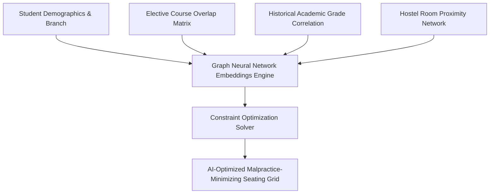

# State Management, Memory Architecture & Data Dictionary
## SEA — Seat Exam Allotment System
**Document Version:** 1.0.0  
**Focus:** Session State, MySQL 8.0 Data Dictionary, Caching & Scalability, AI Roadmap  

---

## 1. State Management Strategy

SEA partitions system state into distinct lifecycle boundaries across the client and server tiers:

```mermaid
graph TD
    subgraph Client State [Browser SessionStorage]
        C1[Authenticated User Profile & Role]
        C2[Active JWT Token]
        C3[Selected Exam & Hall Filters]
        C4[Offline Fallback Cache]
    end

    subgraph Server State [Stateless Spring Boot]
        S1[SecurityContext ThreadLocal]
        S2[Anti-Malpractice In-Memory Matrix]
        S3[HMAC Signing Keys]
    end

    subgraph Persistent State [MySQL 8.0 Engine]
        D1[Master Rosters: Students, Teachers, Halls]
        D2[Seat Allocations Matrix]
        D3[Cryptographic QR Verification Registry]
        D4[Live Attendance Log]
    end

    Client State -->|Bearer Token HTTP Headers| Server State
    Server State -->|ACID Transactions| Persistent State
```

### 1.1. Client-Side State
- **Storage Mechanism:** Browser `sessionStorage` (cleared automatically upon tab close or explicit logout).
- **Payload Structure:**
```json
{
  "success": true,
  "role": "ADMIN",
  "userId": 1,
  "username": "admin",
  "name": "Dr. R. Gawande (HOD)",
  "token": "eyJhbGciOiJIUzI1NiIsInR5cCI6IkpXVCJ9..."
}
```
- **State Invalidation:** Invoked via `logout()` method in `api.js`:
```javascript
sessionStorage.clear();
window.location.href = 'index.html';
```

### 1.2. Server-Side State
- **Stateless Architecture:** Spring Boot instances hold zero persistent session state across requests.
- **Security Context:** Requests inject bearer tokens into `JwtAuthenticationFilter`, which decrypts the claims and establishes a request-scoped `UsernamePasswordAuthenticationToken` in `SecurityContextHolder`.

---

## 2. Database Schema Dictionary (MySQL 8.0)

### 2.1. Table: `users`
*Unified authentication credentials with BCrypt hashing and role-based permissions.*

| Column | Type | Nullable | Key | Default | Description |
|---|---|---|---|---|---|
| `id` | `BIGINT` | No | PK | `AUTO_INCREMENT` | Unique user identifier |
| `username` | `VARCHAR(64)` | No | UK | None | Unique login username / ID |
| `password` | `VARCHAR(255)` | No | | None | BCrypt hash (10 rounds) |
| `email` | `VARCHAR(120)` | No | UK | None | Institutional email address |
| `full_name` | `VARCHAR(120)` | No | | None | Display name of user |
| `role` | `ENUM('ADMIN','STUDENT','INVIGILATOR')` | No | IDX | `'STUDENT'` | Access authorization role |
| `is_active` | `BOOLEAN` | No | | `TRUE` | Account active status flag |
| `created_at` | `TIMESTAMP` | No | | `CURRENT_TIMESTAMP` | Account creation timestamp |
| `updated_at` | `TIMESTAMP` | Yes | | `ON UPDATE CURRENT_TIMESTAMP` | Last profile update |

### 2.2. Table: `students`
*Academic candidate profiles used for branch separation and hall ticket distribution.*

| Column | Type | Nullable | Key | Default | Description |
|---|---|---|---|---|---|
| `id` | `BIGINT` | No | PK | `AUTO_INCREMENT` | Primary key |
| `roll_no` | `VARCHAR(32)` | No | UK, IDX | None | Permanent university roll number |
| `name` | `VARCHAR(120)` | No | | None | Candidate full name |
| `department` | `VARCHAR(32)` | No | IDX | None | Branch acronym (CS, IT, AI, MECH) |
| `year` | `INT` | No | IDX | None | Academic year (1, 2, 3, 4) |
| `semester` | `INT` | No | | None | Current semester (1–8) |
| `email` | `VARCHAR(120)` | Yes | | None | Student email address |
| `phone` | `VARCHAR(20)` | Yes | | None | Contact mobile number |
| `user_id` | `BIGINT` | Yes | FK | `NULL` | Reference to `users(id)` |

### 2.3. Table: `halls`
*Examination hall physical properties and matrix seat capacity.*

| Column | Type | Nullable | Key | Default | Description |
|---|---|---|---|---|---|
| `id` | `BIGINT` | No | PK | `AUTO_INCREMENT` | Primary key |
| `hall_number` | `VARCHAR(32)` | No | UK | None | Room designation (e.g. "Hall C") |
| `block` | `VARCHAR(32)` | No | IDX | None | Campus building block |
| `floor` | `VARCHAR(16)` | No | | `'Ground'` | Floor level |
| `total_rows` | `INT` | No | | `5` | Physical bench rows ($R$) |
| `total_cols` | `INT` | No | | `6` | Physical desk columns ($C$) |
| `capacity` | `INT` | No | | `STORED (R * C)` | Computed maximum seat capacity |
| `is_active` | `BOOLEAN` | No | | `TRUE` | Active examination venue flag |

### 2.4. Table: `exams`
*Scheduled examination sessions and subject metadata.*

| Column | Type | Nullable | Key | Default | Description |
|---|---|---|---|---|---|
| `id` | `BIGINT` | No | PK | `AUTO_INCREMENT` | Primary key |
| `exam_code` | `VARCHAR(32)` | No | UK, IDX | None | Unique exam identifier |
| `title` | `VARCHAR(150)` | No | | None | Official examination title |
| `subject` | `VARCHAR(100)` | No | | None | Academic course subject |
| `exam_date` | `DATE` | No | IDX | None | Scheduled calendar date |
| `start_time` | `TIME` | No | | None | Session start time |
| `end_time` | `TIME` | No | | None | Session conclusion time |
| `academic_year`| `VARCHAR(16)` | No | | `'2026-27'` | Academic session |
| `semester` | `INT` | No | | `4` | Target semester |

### 2.5. Table: `seat_assignments`
*Physical seat allotment generated by the anti-malpractice engine.*

| Column | Type | Nullable | Key | Default | Description |
|---|---|---|---|---|---|
| `id` | `BIGINT` | No | PK | `AUTO_INCREMENT` | Primary key |
| `student_id` | `BIGINT` | No | FK, UK | None | Foreign key to `students(id)` |
| `exam_id` | `BIGINT` | No | FK, UK | None | Foreign key to `exams(id)` |
| `hall_id` | `BIGINT` | No | FK, UK | None | Foreign key to `halls(id)` |
| `supervisor_id`| `BIGINT` | Yes | FK | `NULL` | Assigned faculty supervisor |
| `row_number` | `INT` | No | UK | None | Bench row coordinate |
| `col_number` | `INT` | No | UK | None | Bench column coordinate |
| `seat_number` | `VARCHAR(16)` | No | | None | Formatted desk code (`R1-C1`) |
| `qr_code_data`| `VARCHAR(255)`| No | | None | Tamper-proof signed payload string |
| `qr_code_image`| `MEDIUMTEXT` | Yes | | `NULL` | Base64 PNG image Data URL |

### 2.6. Table: `attendance`
*Contactless QR-verified entry records and audit timestamps.*

| Column | Type | Nullable | Key | Default | Description |
|---|---|---|---|---|---|
| `id` | `BIGINT` | No | PK | `AUTO_INCREMENT` | Primary key |
| `seat_assignment_id` | `BIGINT` | No | FK, UK | None | 1-to-1 link ensuring single-use entry |
| `student_id` | `BIGINT` | No | FK, IDX | None | Verified candidate |
| `exam_id` | `BIGINT` | No | FK, IDX | None | Verified examination session |
| `verified_by_teacher_id` | `BIGINT` | Yes | FK | `NULL` | Invigilator who scanned code |
| `status` | `ENUM('PRESENT','ABSENT','MALPRACTICE_FLAGGED')` | No | IDX | `'PRESENT'` | Attendance status |
| `scan_time` | `TIMESTAMP` | No | | `CURRENT_TIMESTAMP` | Exact time of gate verification |
| `device_meta` | `VARCHAR(120)` | Yes | | None | Device / Browser metadata |
| `remarks` | `VARCHAR(255)` | Yes | | None | Supervisor notes |

### 2.7. Table: `qr_verification`
*Cryptographic verification audit registry for tamper detection.*

| Column | Type | Nullable | Key | Default | Description |
|---|---|---|---|---|---|
| `id` | `BIGINT` | No | PK | `AUTO_INCREMENT` | Primary key |
| `qr_payload` | `VARCHAR(255)` | No | | None | Raw payload string |
| `verification_hash` | `VARCHAR(64)` | No | IDX | None | 12-char HMAC-SHA256 signature |
| `student_roll` | `VARCHAR(32)` | No | IDX | None | Candidate roll number |
| `exam_code` | `VARCHAR(32)` | No | IDX | None | Exam code |
| `is_used` | `BOOLEAN` | No | | `FALSE` | Single-use flag preventing replays |
| `verified_at` | `TIMESTAMP` | Yes | | `NULL` | Consumption timestamp |

---

## 3. Caching & Performance Optimization

### 3.1. Query Indexing Strategy
- **$O(1)$ Authentication:** `CREATE UNIQUE INDEX idx_users_username ON users(username)`
- **Immediate Seat Lookup:** `CREATE INDEX idx_sa_student_exam ON seat_assignments(student_id, exam_id)`
- **Real-Time Attendance Aggregation:** `CREATE INDEX idx_att_exam_status ON attendance(exam_id, status)`

### 3.2. Caching Roadmap for High-Concurrency Spikes
During the morning rush (8:30 AM – 9:30 AM), 5,000+ candidates concurrently check their seat numbers.
- **Layer 1 (L1 Application Cache):** In-memory Caffeine cache storing `Exam` and `Hall` metadata (`@Cacheable("exams")`).
- **Layer 2 (L2 Distributed Cache - Planned):** Redis cluster caching pre-rendered seat slips:
  - Cache Key: `seat_slip:{examCode}:{rollNo}`
  - TTL: 12 hours (invalidated if re-allotment is executed).

---

## 4. AI & Machine Learning Roadmap

### 4.1. Current Engine: Deterministic Algorithmic Interleaving
The current system utilizes a deterministic 2D row-offset algorithm that guarantees 100% mathematical branch divergence for horizontally and vertically adjacent seats with zero external training overhead.

### 4.2. Next-Generation AI Adaptive Seating (Phase 5)
In complex multi-disciplinary universities where students from different branches may still know each other (e.g. shared student housing, common elective courses), SEA will introduce **Graph Neural Network (GNN) Seating Optimization**:



#### Objective Function for AI Seating
$$\min \sum_{i=1}^N \sum_{j \in \mathcal{N}(i)} \frac{\text{Similarity}(v_i, v_j)}{\text{EuclideanDistance}(\text{seat}_i, \text{seat}_j)^2}$$
where $v_i$ is the student's multi-attribute feature vector embedding, and $\mathcal{N}(i)$ is the local physical neighborhood in the examination hall.
The AI model maximizes physical distance between candidates with high mutual correlation, eliminating subtle cheating rings.

