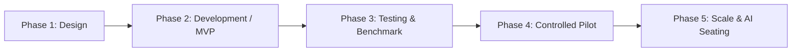

# Project Roadmap & Implementation Phases
## SEA — Seat Exam Allotment System
**Roadmap Framework:** 5-Phase Lifecycle (Design → Development → Testing → Pilot → Scale)  
**Academic Alignment:** 2026–27 Academic Cycle | CuriousParc 2026 Innovation Challenge  

---

---

## Phase 1: Design & Requirements Architecture
**Duration:** Weeks 1–3  
**Status:** Completed  

### Objectives
- Define the operational problem statement: manual 3–4 hour seating delays, cheating risks, proxy attendance.
- Architect relational database entities (Students, Teachers, Halls, Exams, Seating, Attendance, QR Verification).
- Draft UI wireframes and high-fidelity layouts for Admin Dashboard, Student Portal, and Invigilator Scanner.
- Formulate the mathematical 2D row-offset anti-malpractice seating specification.

### Key Deliverables
- Product Requirements Document (`PRD.md`).
- System Architecture Specification (`ARCHITECTURE.md`).
- UI/UX Wireframes and Design Token System (`Design.md`).
- MySQL 8.0 relational schema (`schema.sql`).

---

## Phase 2: Core Development & MVP Engineering
**Duration:** Weeks 4–8  
**Status:** Completed  

### Objectives
- Implement Spring Boot 3 REST backend with Java 17, JPA/Hibernate, and Spring Security.
- Develop the **1-Click Anti-Malpractice Seating Algorithm** supporting 500+ seat allocations in sub-second time.
- Implement cryptographic HMAC-SHA256 QR code generation using Google ZXing.
- Implement HTML5 QR camera scanner using `html5-qrcode` with manual desktop simulation fallback.
- Integrate frontend client layer (`api.js`) with responsive Bootstrap 5 dashboards.

### Key Deliverables
- Spring Boot Application source code (`backend/src/main/java/com/sea/...`).
- Maven build configuration (`backend/pom.xml`).
- Seed datasets with realistic student and faculty records (`database/data.sql`).
- Functional frontend portals:
  - Admin Management & Seating: `admin-dashboard.html`, `admin-seating.html`, `admin-students.html`, `admin-halls.html`, `exam-center.html`.
  - Student Seat Details & PDF Slip: `student-dashboard.html`, `student-seat-details.html`.
  - Invigilator Camera Scanner: `invigilator-dashboard.html`, `invigilator-scanner.html`, `invigilator-attendance.html`.

---

## Phase 3: Testing, Quality Assurance & Benchmarking
**Duration:** Weeks 9–11  
**Status:** Completed  

### Objectives
- Conduct algorithmic stress tests on datasets scaling from 50 to 1,000 students.
- Verify that horizontal and vertical same-branch adjacency collisions strictly equal 0%.
- Test cryptographic tamper detection: verify that modified QR codes return HTTP 403 Forbidden.
- Test anti-proxy enforcement: verify that duplicate scans return HTTP 409 Conflict.
- Validate cross-browser camera compatibility on iOS Safari and Android Chrome.

### Key Deliverables
- Python stress test benchmark (`python_utils/stress_test_allotment.py`):
  - Result: **540 seats allotted in 0.57 ms with 100.00% Anti-Malpractice success (0 collisions)**.
- 500+ student seed data generator (`python_utils/seed_data_generator.py`).
- Security audit report verifying BCrypt password hashing and JWT token isolation.

---

## Phase 4: Controlled Campus Pilot & Field Trials
**Duration:** Weeks 12–16  
**Status:** Scheduled (Pre-Production Pilot)  

### Objectives
- Deploy the system in a controlled mid-term examination session at Matoshri College of Engineering and Research Centre, Nashik for 500+ candidates.
- Deploy backend on cloud container platform (Render/Heroku) with managed MySQL database.
- Deploy frontend client to high-speed global CDN (Vercel).
- Train 15 faculty invigilators on smartphone QR gate verification.
- Implement SMS and Email notification dispatch gateways for instant seat assignment alerts.

### Key Deliverables
- Cloud deployment configuration (`vercel.json`, `Dockerfile`, Render Procfile).
- Invigilator quick-start field guide.
- Real-world user feedback report from faculty and students.
- Attendance audit report comparing digital entry times against manual paper baseline.

---

## Phase 5: Campus Scale, Multi-Tenancy & AI Roadmap
**Duration:** Academic Year 2026–27  
**Status:** Planned  

### Objectives
- **Multi-Tenant SaaS Architecture:** Enable multi-college support where multiple universities operate isolated examination instances on a single shared infrastructure.
- **AI-Driven Adaptive Seating:**
  - Machine learning optimization clustering students not only by department, but dynamically factoring historical academic performance, student friendship network graphs, and elective combinations.
  - Anomaly detection models analyzing hall entry timestamps to detect suspicious clustered entry patterns.
- **Biometric Face Verification Integration:** Optional dual-factor gate entry combining QR seat slip scan with facial recognition matching student ID photos.
- **Mobile Native Applications:** Flutter/Android cross-platform apps with offline-cached QR verification for regions with unstable cellular connectivity.

### Milestone Tracking Summary

| Milestone | Target Horizon | Status | Success Criteria |
|---|---|---|---|
| M1: Architecture & Schema | Week 2 | Done | Approved schema and ER models |
| M2: Core Seating Engine | Week 6 | Done | Sub-second execution for 500+ seats |
| M3: QR Scanner & Portals | Week 8 | Done | 3 functional responsive portals |
| M4: Algorithmic Verification | Week 11 | Done | 100% anti-malpractice, 0 collisions |
| M5: Cloud Deployment & Pilot | Week 16 | Ready | Production deployment on Vercel & Render |
| M6: Multi-College Scale & AI | Future | Roadmap | Multi-tenant SaaS with AI seating |

